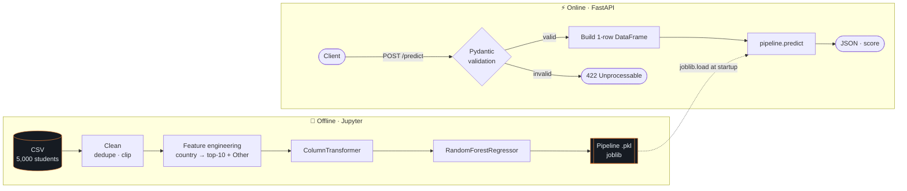
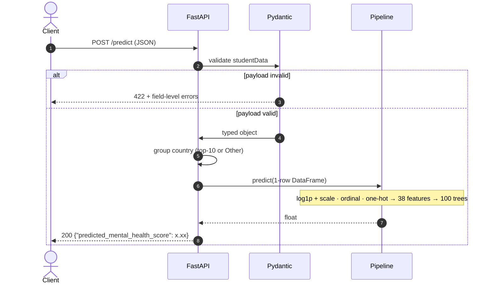
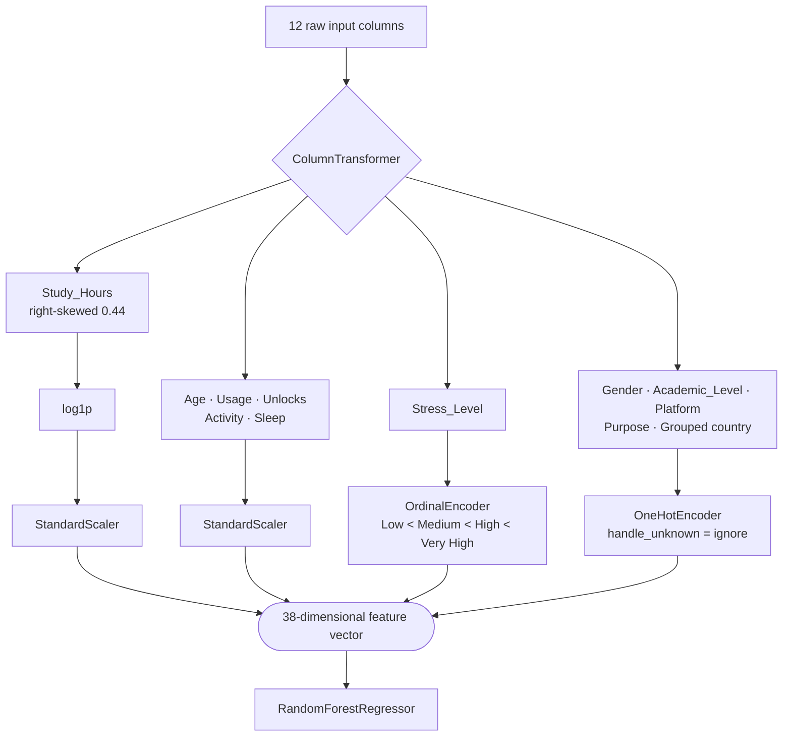

<div align="center">

# 🧠 Student Mental Health Score Predictor

### A production-style ML service that turns social-media habits, sleep, study and stress into a predicted mental-health score — served through a validated FastAPI endpoint.

<br>


<br>

| 🎯 Task | 🌲 Model | 📈 Test R² | 📉 MAE | 🧪 Rows |
|:---:|:---:|:---:|:---:|:---:|
| Regression | Random Forest | **0.878** | **0.35** score pts | 5,000 |

<br>


</div>

<!-- DEMO: drop your demo video / GIF here, e.g.
<p align="center"><a href="YOUR_YOUTUBE_LINK"></a></p>
-->

---

## 📑 Table of Contents

- [✨ Highlights](#-highlights)
- [🏗️ Architecture](#️-architecture)
  - [2D system view](#2d-system-view)
  - [3D layered view](#3d-layered-view)
  - [Request lifecycle](#request-lifecycle)
  - [Preprocessing graph](#preprocessing-graph)
- [🔬 The Machine-Learning Story](#-the-machine-learning-story)
- [📊 Results](#-results)
- [🧭 What the Model Learned](#-what-the-model-learned)
- [🚀 Quick Start](#-quick-start)
- [🔌 API Reference](#-api-reference)
- [🗂️ Project Structure](#️-project-structure)
- [🛠️ Troubleshooting](#️-troubleshooting)
- [⚠️ Limitations & Honest Notes](#️-limitations--honest-notes)
- [🗺️ Roadmap](#️-roadmap)
- [👤 Author](#-author)

---

## ✨ Highlights

- **One artifact, zero drift.** Preprocessing and model are saved as a single `sklearn.Pipeline`. The API never re-implements scaling or encoding, so training and serving cannot disagree.
- **Strict input contracts.** Pydantic enforces numeric ranges and closed sets of categories. Bad payloads get a `422` before they ever reach the model.
- **Thoughtful feature engineering.** 111 raw countries collapse to 10 + `Other`, avoiding 110 near-empty one-hot columns while keeping geographic signal.
- **Honest evaluation.** Linear baseline vs. default vs. tuned Random Forest, with train/test gaps reported, not hidden.
- **Reproducible visuals.** Every chart in this README is regenerated by [`generate_assets.py`](generate_assets.py), including 3D plots drawn from the real serialized model.
- **Self-documenting API.** Swagger UI and ReDoc come free at `/docs` and `/redoc`.

---

## 🏗️ Architecture

The system has two lanes that meet at one file: an **offline** lane (notebook → trained pipeline) and an **online** lane (FastAPI → prediction).

### 2D system view

<div align="center">

</div>



### 3D layered view

Each slab is a layer with a single responsibility; arrows of dependency run bottom to top.

<div align="center">

</div>

### Request lifecycle



### Preprocessing graph



---

## 🔬 The Machine-Learning Story

| Step | Decision | Why |
|---|---|---|
| **Data** | 5,000 students × 13 columns, 111 countries, no nulls | Target `Mental_Health_Score` is continuous (≈ 3–10), so this is **regression** |
| **Cleaning** | Dropped 2 duplicate rows | Duplicates silently bias a model toward whatever repeats |
| | `Physical_Activity_Hours` had a minimum of **−0.4** → `clip(lower=0)` | Negative hours are impossible; clipping keeps the rest of that student's valid data |
| **Skewness** | Only `Study_Hours` was meaningfully skewed (0.44) → `log1p` | Helps the linear baseline; harmless for trees |
| **Feature engineering** | Country → top 10 by frequency, everything else → `Other` | Avoids high-cardinality blow-up without throwing away signal |
| **Encoding** | `Stress_Level` ordinal; other categoricals one-hot | Only stress has a real order |
| **Split** | 70 / 30, `random_state=42`, split **before** fitting any transformer | Prevents data leakage |
| **Models** | Linear Regression → Random Forest → tuned Random Forest (`RandomizedSearchCV`, 15 iters × 5-fold) | Baseline first, then test whether non-linearity helps |
| **Shipped** | Default Random Forest (100 trees) | Best test R² and lowest MAE of the three |

---

## 📊 Results

<div align="center">

</div>

| Model | Test R² | Train R² | Gap | MAE | RMSE |
|---|:---:|:---:|:---:|:---:|:---:|
| Linear Regression | 0.740 | 0.724 | −0.016 | 0.536 | 0.676 |
| **Random Forest (default) ✅ shipped** | **0.878** | 0.981 | +0.103 | **0.347** | **0.464** |
| Random Forest (tuned) | 0.865 | 0.955 | +0.090 | 0.369 | 0.487 |

**How to read it.** On average the shipped model misses the true score by about **0.35 points**. The Random Forest beats the linear baseline by ~14 R² points, which confirms non-linear structure in the data. The tuned forest narrowed the train/test gap but did not improve test error, so the simpler default was kept. Both forests still show a visible train/test gap — see [Limitations](#️-limitations--honest-notes).

---

## 🧭 What the Model Learned

### Feature importance

<div align="center">

</div>

Daily social-media usage dominates (**≈ 69%** of total importance), followed by sleep (≈ 10%). One-hot columns are summed back to their original feature so the chart reflects real inputs, not encoded fragments.

### 3D response surface

Predicted score as a function of usage and sleep, computed by calling the **actual serialized pipeline** on a grid (all other inputs held fixed).

<div align="center">

</div>

> The surface is a narrow ribbon because usage and sleep are strongly correlated in the training data (r ≈ −0.81). Regions off that diagonal are extrapolation, and a Random Forest simply holds its nearest learned value there.

### Stress ladder

<div align="center">

</div>

The curves for the four stress levels nearly overlap. Even though the raw EDA shows stress and score moving together, the model attributes almost all of that signal to usage, sleep and study hours, which are correlated with stress.

<details>
<summary><b>🔍 Exploratory Data Analysis gallery</b> (click to expand)</summary>
<br>

| Target distribution | Correlation heatmap |
|:---:|:---:|
|  |  |

| Stress vs. score | Usage vs. score |
|:---:|:---:|
|  |  |

| Sleep vs. score | Most-used platform |
|:---:|:---:|
|  |  |

**Key observations:** usage and daily unlocks are almost the same signal (r = 0.96); usage correlates −0.82 with the score; sleep +0.77; study hours +0.75; Instagram and TikTok are the most common platforms.

</details>

---

## 🚀 Quick Start

### Prerequisites

- Python **3.12** (the version the notebook was developed on; other recent 3.x versions should work but are untested)
- `scikit-learn==1.6.1` — the pickle was serialized with this exact version, and sklearn pickles are not guaranteed to load across versions

### 1 · Clone and install

```bash
git clone https://github.com/loisekk/mental-health-score-predictor.git
cd mental-health-score-predictor

python -m venv .venv
source .venv/bin/activate          # Windows: .venv\Scripts\activate
pip install -r requirements.txt
```

### 2 · Place the model

`main.py` loads the model by this exact filename, spaces included:

```
RF Mental Health Model.pkl
```

Put it in the project root next to `main.py`.

### 3 · Run

```bash
uvicorn main:app --reload
```

| URL | What |
|---|---|
| http://127.0.0.1:8000/home | Welcome route |
| http://127.0.0.1:8000/docs | **Interactive Swagger UI** — try `/predict` in the browser |
| http://127.0.0.1:8000/redoc | ReDoc documentation |

### 4 · Regenerate the README visuals *(optional)*

```bash
pip install matplotlib
python generate_assets.py --model "RF Mental Health Model.pkl"
```

---

## 🔌 API Reference

### `GET /home`

Health / welcome check.

### `POST /predict`

**Request body**

| Field | Type | Constraint |
|---|---|---|
| `Age` | int | 10 – 100 |
| `Gender` | enum | `Male` · `Female` |
| `country` | string | any; mapped to a top-10 country or `Other` server-side |
| `Academic_Level` | enum | `High School` · `Undergraduate` · `Graduate` |
| `Most_Used_Platform` | enum | `Facebook` · `LinkedIn` · `Instagram` · `Snapchat` · `Twitter` · `YouTube` · `TikTok` · `LINE` · `KakaoTalk` · `VKontakte` · `WhatsApp` · `WeChat` |
| `Purpose_Of_Use` | enum | `Networking` · `Education` · `Entertainment` · `News` |
| `Avg_Daily_Usage_Hours` | float | 0 – 24 |
| `Daily_Unlocks` | int | ≥ 0 |
| `Study_Hours` | float | 0 – 24 |
| `Physical_Activity_Hours` | float | 0 – 24 |
| `Sleep_Hours_Per_Night` | float | 0 – 24 |
| `Stress_Level` | enum | `Low` · `Medium` · `High` · `Very High` |

> Note the lowercase `country` key — it is the only field that is not capitalized.

**Example**

```bash
curl -X POST http://127.0.0.1:8000/predict \
  -H "Content-Type: application/json" \
  -d '{
    "Age": 21,
    "Gender": "Female",
    "country": "India",
    "Academic_Level": "Undergraduate",
    "Most_Used_Platform": "Instagram",
    "Purpose_Of_Use": "Entertainment",
    "Avg_Daily_Usage_Hours": 5.5,
    "Daily_Unlocks": 180,
    "Study_Hours": 3.0,
    "Physical_Activity_Hours": 1.5,
    "Sleep_Hours_Per_Night": 6.5,
    "Stress_Level": "High"
  }'
```

**Response `200`**

```json
{ "predicted_mental_health_score": 6.05 }
```

**Sample profiles** (same model, same pipeline)

| Profile | Usage | Unlocks | Sleep | Stress | Predicted |
|---|:---:|:---:|:---:|:---:|:---:|
| Balanced habits | 2.0 h | 80 | 8.0 h | Low | **7.68** |
| Typical student (example above) | 5.5 h | 180 | 6.5 h | High | **6.05** |
| Heavy use, short sleep | 8.0 h | 250 | 5.0 h | Very High | **4.74** |

**Response `422`** — returned automatically when a field is out of range or not an allowed value.

**Python client**

```python
import requests

payload = {
    "Age": 21, "Gender": "Female", "country": "India",
    "Academic_Level": "Undergraduate", "Most_Used_Platform": "Instagram",
    "Purpose_Of_Use": "Entertainment", "Avg_Daily_Usage_Hours": 5.5,
    "Daily_Unlocks": 180, "Study_Hours": 3.0, "Physical_Activity_Hours": 1.5,
    "Sleep_Hours_Per_Night": 6.5, "Stress_Level": "High",
}
r = requests.post("http://127.0.0.1:8000/predict", json=payload, timeout=10)
print(r.json())
```

---

## 🗂️ Project Structure

```
.
├── main.py                       # FastAPI app: schemas, validation, /home, /predict
├── Mental_Health_score.ipynb     # EDA → cleaning → features → models → export
├── RF Mental Health Model.pkl    # Serialized sklearn Pipeline (~25 MB)
├── generate_assets.py            # Rebuilds every chart and diagram below
├── requirements.txt
├── LICENSE
├── README.md
└── assets/
    ├── architecture_2d.png
    ├── architecture_3d.png
    ├── model_comparison.png
    ├── feature_importance.png
    ├── prediction_surface_3d.png
    ├── stress_ladder.png
    └── eda_*.png                 # six plots exported from the notebook
```

---

## 🛠️ Troubleshooting

| Symptom | Cause | Fix |
|---|---|---|
| `FileNotFoundError` on startup | Model filename differs from the one `main.py` loads | Name it exactly `RF Mental Health Model.pkl` |
| `InconsistentVersionWarning` or unpickling errors | scikit-learn version differs from training | `pip install scikit-learn==1.6.1` |
| `500` with `columns are missing: {'Country_Grouped'}` | Pickle was exported from an older notebook revision whose column was named `Country_Grouped`; `main.py` sends `Grouped_country`, matching the current notebook | Re-export the pipeline from the current notebook (section 14) so the column names match |
| `422 Unprocessable Entity` | Payload violates a validation rule | Read the `detail` array in the response; it names the failing field |

---

## ⚠️ Limitations & Honest Notes

This is a **portfolio and learning project**, not a clinical tool.

- **Not medical advice.** The score is a statistical output on one dataset. It must not be used to assess, diagnose or make decisions about any real person.
- **Highly structured data.** Usage, unlocks, sleep and study hours are strongly inter-correlated (up to |r| = 0.96), which is unusual for real survey data. High R² here says more about the dataset's structure than about real-world predictability.
- **Correlation ≠ causation.** The model finds associations; it does not show that reducing screen time raises anyone's score.
- **Overfitting signal.** The shipped forest reaches 0.98 train R² vs. 0.88 test R². Cross-validated reporting and stronger regularisation are on the roadmap.
- **Narrow population.** Ages 18–24 in training, but the API accepts 10–100. Predictions outside the training range are extrapolations.
- **Country grouping** is frequency-based; "Other" covers ~65% of rows, so country carries limited signal (~3% importance).

---

## 🗺️ Roadmap

- [ ] Pin all dependency versions in `requirements.txt` and add a `Dockerfile`
- [ ] Cross-validated metrics and learning curves in the notebook
- [ ] Model card documenting data provenance and intended use
- [ ] `/health` and `/model-info` endpoints (version, feature list, training date)
- [ ] Pytest suite for schema validation and a prediction smoke test
- [ ] Deploy to a cloud host with CI on push
- [ ] Lightweight frontend that calls `/predict`
- [ ] SHAP explanations per prediction

---

## 👤 Author

**Yash Brahmankar** — B.Tech, Artificial Intelligence & Machine Learning · Oriental Institute of Science & Technology, Bhopal

[](https://github.com/loisekk)

Released under the [MIT License](LICENSE). If this project helped you, a ⭐ is appreciated.
